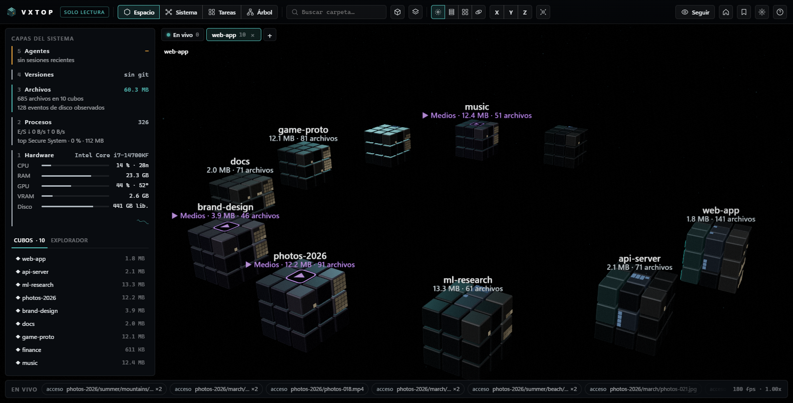

<p align="center"></p>

<p align="center"><a href="README.md">Español</a> · <b>English</b></p>

# Prisma

**A 3D interface for Claude on your own computer.** You talk to Claude in a dark space; every folder is a cube,
every program floats above them, and whatever Claude looks at or changes lights up in front of you.

Prisma is built on [vxtop](https://github.com/vxtop/vxtop) by virtuanista (see [NOTICE](NOTICE)).

**[Website](https://vxtop.github.io/prisma/)** · Prisma and vxtop are two separate projects by the same author.



| | Prisma | [vxtop](https://github.com/vxtop/vxtop) |
|---|---|---|
| Purpose | Talk to Claude and work with it | Watch what your computer is doing |
| Can change files | Yes, in work mode, inside one folder | Never |
| Folders | Cubes you enter, with cubes inside | Cubes of 27 data cells |
| Colour means | The kind of content | Who touched each file |
| Needs Claude Code | For the assistant | No |
| Port and data | 4828, `~/.prisma` | 4827, `~/.vxtop` |

## What it does

- **Talk to Claude from the space.** The prompt bar uses the Claude Code you already have installed and logged in
  (standalone or the copy Claude Desktop downloads), with every account on the machine. No API keys, no login screen.
- **Observe mode** (default): Claude can only look. It inspects folders, files, processes and AI sessions through a
  read-only MCP server and shows its answer by opening cubes, focusing them and arranging spaces.
- **Work mode**: Claude can edit files inside the folder of the selected cube, never outside it, and never runs
  programs.
- **Live view**: folders light up when something touches them; particles show who touched each file — Claude in its
  own colour, you in pearl, other programs in silver.
- **Systems, tasks, tree, gallery and viewers** inherited from vxtop, all read-only.

## Colour language

Colours name kinds of things and never change meaning:

| Gem | Hex | Meaning |
|---|---|---|
| Sapphire | `#1768B5` | Code |
| Emerald | `#269B65` | Data |
| Gold | `#E6B844` | Documents and media |
| Silver | `#AEB9C5` | Folders, drives, other programs |
| Ruby | `#C52235` | Executables, deletions and errors |
| Onyx | `#252B35` | Surfaces: matte graphene cubes and panels |
| Pearl | `#F0EBDD` | Text and your own activity |

Claude keeps its own colour (`#D97757`).

## Requirements

- Node.js 18.15 or later (no npm dependencies)
- Chrome or Edge
- Claude Code installed and logged in, for the assistant
- Windows is the most complete platform; Linux works; macOS is untested

## Run

```sh
node server.js           # http://127.0.0.1:4828/
npm run dev              # same, with hot reload of the interface and safe server restarts
```

On Windows, double-click `prisma.vbs` for a window of its own.

Data lives in `~/.prisma` (indexes, scenes, token, assistant sessions). Prisma never shares it with vxtop.

## Documentation

- [Assistant](docs/assistant.md): installations, accounts, isolation, work mode, hot reload
- [Architecture](docs/architecture.md) · [Guía (es)](docs/guia.md) · [Guide (en)](docs/en/guide.md)

## License

[Apache-2.0](LICENSE). Keep [NOTICE](NOTICE) when redistributing.

<p align="center">
	Repository made by <a href="https://github.com/virtuanista" target="_blank">virtu 🎣</a>
</p>

<p align="center">
	
</p>

<p align="center">
	Copyright &copy; 2026
</p>

<p align="center">
	<a href="LICENSE"></a>
</p>
