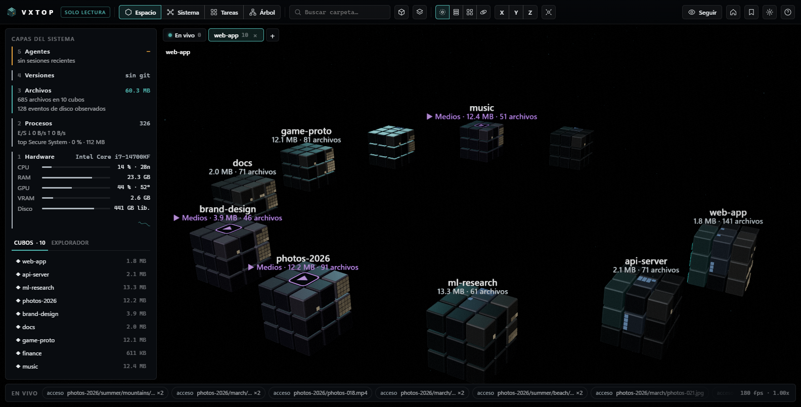

<p align="center"></p>

<p align="center"><b>Español</b> · <a href="README.en.md">English</a></p>

# Prisma

**Una interfaz 3D para Claude en tu propio equipo.** Hablas con Claude en un espacio oscuro: cada carpeta es un cubo,
los programas flotan por encima y todo lo que Claude mira o cambia se ilumina delante de ti.

Prisma nace de [vxtop](https://github.com/vxtop/vxtop), de virtuanista (ver [NOTICE](NOTICE)).

**[Web](https://vxtop.github.io/prisma/)** · Prisma y vxtop son dos proyectos distintos de la misma autoría.



| | Prisma | [vxtop](https://github.com/vxtop/vxtop) |
|---|---|---|
| Para qué | Hablar con Claude y trabajar con él | Ver qué está haciendo tu equipo |
| Puede cambiar archivos | Sí, en modo trabajo y dentro de una carpeta | Nunca |
| Carpetas | Cubos a los que se entra, con cubos dentro | Cubos de 27 celdas de datos |
| El color indica | El tipo de contenido | Quién ha tocado cada archivo |
| Necesita Claude Code | Para el asistente | No |
| Puerto y datos | 4828, `~/.prisma` | 4827, `~/.vxtop` |

## Qué hace

- **Hablar con Claude desde el espacio.** La barra usa el Claude Code que ya tienes instalado y con la sesión iniciada
  (el independiente o la copia que descarga Claude Desktop), con todas las cuentas del equipo. Sin claves de API ni
  pantalla de inicio de sesión.
- **Modo observar** (por defecto): Claude solo puede mirar. Inspecciona carpetas, archivos, procesos y sesiones de IA
  con un servidor MCP de solo lectura, y responde abriendo cubos, enfocándolos y ordenando espacios.
- **Modo trabajo**: Claude puede editar archivos dentro de la carpeta del cubo seleccionado, nunca fuera de ella, y
  nunca ejecuta programas.
- **Vista en vivo**: las carpetas se iluminan cuando algo las toca y unas partículas muestran quién ha tocado cada
  archivo: Claude con su propio color, tú en perla y los demás programas en plata.
- **Sistema, tareas, árbol, galería y visores** heredados de vxtop, todos de solo lectura.

## El lenguaje del color

Cada color nombra un tipo de cosa y nunca cambia de significado:

| Gema | Hex | Significado |
|---|---|---|
| Zafiro | `#1768B5` | Código |
| Esmeralda | `#269B65` | Datos |
| Oro | `#E6B844` | Documentos y medios |
| Plata | `#AEB9C5` | Carpetas, unidades y otros programas |
| Rubí | `#C52235` | Ejecutables, borrados y errores |
| Ónice | `#252B35` | Superficies: cubos y paneles de grafeno mate |
| Perla | `#F0EBDD` | Texto y tu propia actividad |

Claude conserva su propio color (`#D97757`).

## Requisitos

- Node.js 18.15 o superior (sin dependencias de npm)
- Chrome o Edge
- Claude Code instalado y con la sesión iniciada, para el asistente
- Windows es la plataforma más completa; Linux funciona; macOS no está probado

## Arrancar

```sh
node server.js           # http://127.0.0.1:4828/
npm run dev              # lo mismo, con recarga en caliente de la interfaz y reinicios seguros del servidor
```

En Windows, haz doble clic en `prisma.vbs` para abrirlo en su propia ventana.

Los datos están en `~/.prisma` (índices, escenas, token y sesiones del asistente). Prisma nunca los comparte con vxtop.

## Documentación

- [Asistente](docs/asistente.md): instalaciones, cuentas, aislamiento, modo trabajo y recarga en caliente
- [Guía](docs/guia.md) · [Arquitectura](docs/arquitectura.md) · [Registro de cambios](CHANGELOG.md)
- En inglés: [Assistant](docs/assistant.md) · [Guide](docs/en/guide.md) · [Architecture](docs/architecture.md)

## Licencia

[Apache-2.0](LICENSE). Conserva [NOTICE](NOTICE) al redistribuir.

<p align="center">
	Repositorio generado por <a href="https://github.com/virtuanista" target="_blank">virtu 🎣</a>
</p>

<p align="center">
	
</p>

<p align="center">
	Copyright &copy; 2026
</p>

<p align="center">
	<a href="LICENSE"></a>
</p>
